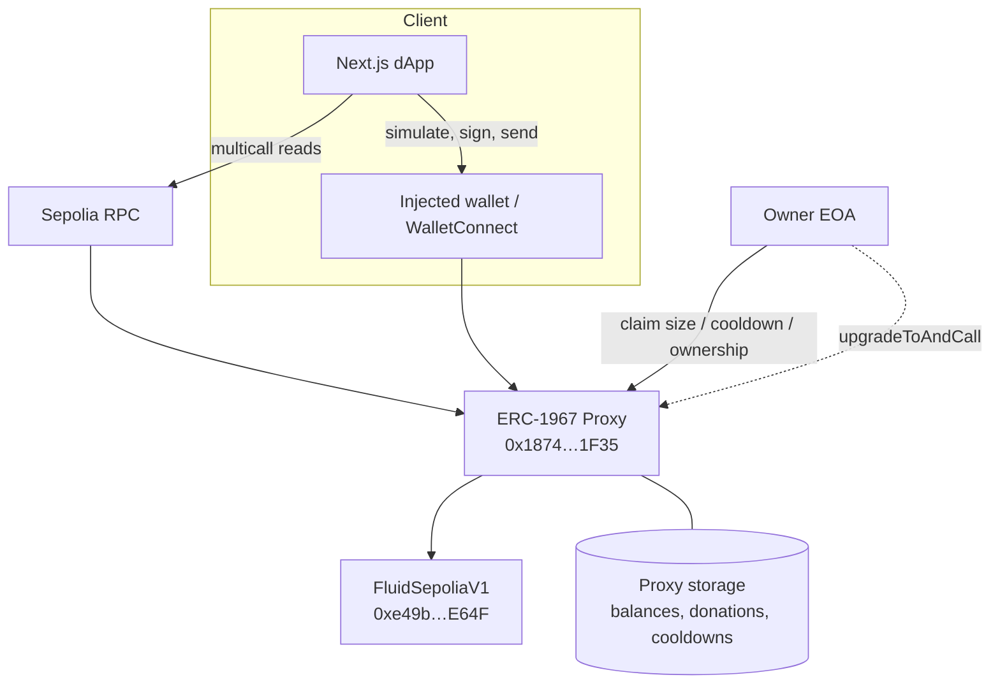
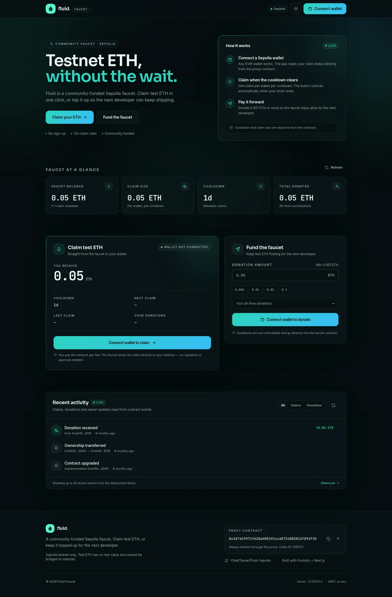
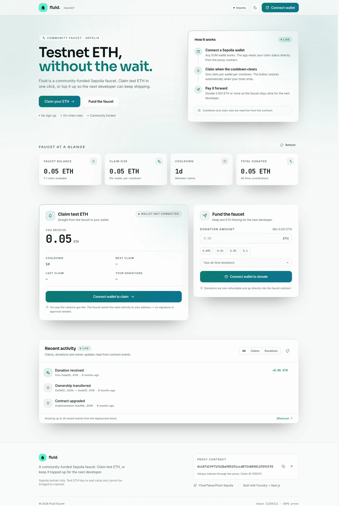

<div align="center">

# Fluid Sepolia

**A community-funded Sepolia ETH faucet for builders, with a production-grade Next.js dApp.**

[](https://soliditylang.org)
[](https://book.getfoundry.sh)
[](https://sepolia.etherscan.io/address/0x1874C9971f63Da905291ccdD7348D5811FD91F35)
[](https://nextjs.org)
[](https://www.typescriptlang.org)
[](https://wagmi.sh)

[Live contract](https://sepolia.etherscan.io/address/0x1874C9971f63Da905291ccdD7348D5811FD91F35) · [Frontend docs](frontend/README.md) · [Repository](https://github.com/Y0sefTamer/Fluid-Sepolia)

</div>

> **Always interact with the proxy.** The proxy holds the funds and state; the implementation holds the logic. The addresses below are on Sepolia only.

## Contents

- [Overview](#overview)
- [Live deployment](#live-deployment)
- [Architecture](#architecture)
- [Frontend](#frontend)
- [Quickstart](#quickstart)
- [Contract API](#contract-api)
- [Security model](#security-model)
- [Testing](#testing)
- [Deployment and upgrades](#deployment-and-upgrades)
- [Repository layout](#repository-layout)
- [Troubleshooting](#troubleshooting)
- [Built with](#built-with)

## Overview

Getting Sepolia ETH can be a bottleneck for new developers. Fluid lets anyone fund a shared faucet, while giving each wallet a fixed claim after a cooldown. The owner can tune the claim size and cooldown without redeploying, and the UUPS proxy preserves state across future logic upgrades.

The repository contains:

- A Solidity faucet built with Foundry and OpenZeppelin Upgradeable.
- A UUPS / ERC-1967 proxy deployment on Sepolia.
- A responsive Next.js dApp with live stats, claim countdown, donations, an activity feed, and an owner console.
- Typed contract reads and writes via wagmi + viem, with simulation before every transaction.

### Highlights

| | |
| --- | --- |
| **Community funded** | Anyone can top up the faucet with at least `0.001 ETH`. |
| **Fixed claims** | Each wallet receives the configured claim amount, currently `0.05 ETH`. |
| **Cooldown protected** | One claim per wallet per cooldown, currently `24 hours`. |
| **Owner controls** | Update claim size, cooldown, or ownership through the proxy. |
| **Upgradeable** | UUPS upgrades keep the same proxy address and storage. |
| **Complete frontend** | Wrong-network guard, decoded errors, activity feed, dark/light themes, mobile layout. |

## Live deployment

| Item | Value |
| --- | --- |
| Network | Sepolia Testnet (`11155111`) |
| Proxy / interaction address | [`0x1874C9971f63Da905291ccdD7348D5811FD91F35`](https://sepolia.etherscan.io/address/0x1874C9971f63Da905291ccdD7348D5811FD91F35) |
| Implementation | [`0xe49b3E34747b25Ed5E681A762d6C77B49Fd8E64F`](https://sepolia.etherscan.io/address/0xe49b3E34747b25Ed5E681A762d6C77B49Fd8E64F) |
| Owner | [`0xde1D740C1990364F7eB6265267D5A55b40056116`](https://sepolia.etherscan.io/address/0xde1D740C1990364F7eB6265267D5A55b40056116) |
| Claim size | `0.05 ETH` |
| Cooldown | `86,400 seconds` (24 hours) |
| Minimum donation | `0.001 ETH` |
| Proxy deployment block | `10,383,029` |
| Upgrade pattern | UUPS (ERC-1967) |

Claim size and cooldown are owner-configurable on-chain. The values above describe the current deployment; read `getWithdrawalAmount()` and `getCooldownTime()` for the authoritative values. The faucet balance and donation totals are live state and are intentionally not hardcoded here.

## Architecture



The implementation constructor disables initializers. `initialize()` sets the deployer as owner, seeds `withdrawalAmount` to `0.05 ether`, and sets `cooldownTime` to `1 days`. Storage is isolated in `FluidSepoliaLayout` with a 50-slot gap for future upgrades.

## Frontend

<p align="center">
  
  
</p>
<p align="center"><sub>Desktop dashboard, dark and light themes</sub></p>

<p align="center">
  
</p>
<p align="center"><sub>Responsive mobile layout at 360 px</sub></p>

The dApp is in [`frontend/`](frontend/README.md) and is intentionally Sepolia-only.

- **Reads** use a Sepolia public client and multicall, even if the connected wallet is on another network.
- **Writes** are simulated first, then signed, then awaited for a receipt before queries are invalidated.
- **States covered:** disconnected, wrong network, awaiting wallet confirmation, pending, confirmed, failed, and user-rejected.
- **Activity feed** parses `DonationReceived`, `WithdrawalMade`, `WithdrawalAmountUpdated`, `CooldownTimeUpdated`, and `Upgraded` events from the deployment block.
- **Owner console** appears only for the on-chain owner and supports claim size, cooldown, ownership transfer, and renouncement.
- **Upgrades are deliberately not exposed in the UI.** Use a dedicated multisig and audited tooling for `upgradeToAndCall`.

### Frontend environment

All variables are public and safe to expose to the browser.

| Variable | Default | Purpose |
| --- | --- | --- |
| `NEXT_PUBLIC_FLUID_CONTRACT_ADDRESS` | Live proxy address | Proxy address, validated and checksummed at startup |
| `NEXT_PUBLIC_SEPOLIA_RPC_URL` | `https://sepolia.gateway.tenderly.co` | Reads and the historical activity scan |
| `NEXT_PUBLIC_ACTIVITY_FROM_BLOCK` | `10383029` | First block used by the activity feed |
| `NEXT_PUBLIC_WALLETCONNECT_PROJECT_ID` | empty | Optional; without it only injected wallets are offered |
| `NEXT_PUBLIC_GITHUB_URL` | Repository URL | Footer source link |

Do not put private keys, mnemonics, or secret API keys in a `NEXT_PUBLIC_*` variable.

## Quickstart

### Prerequisites

- [Foundry](https://book.getfoundry.sh/getting-started/installation) for the contracts.
- Node.js 20.9+ and pnpm for the frontend.
- A Sepolia RPC endpoint and a funded deployer account only if you are deploying.

### Contracts

```bash
git clone --recursive https://github.com/Y0sefTamer/Fluid-Sepolia.git
cd FluidSepolia

make install   # installs OpenZeppelin
forge build
forge test
```

If you already cloned without submodules:

```bash
git submodule update --init --recursive
```

### Frontend

```bash
cd frontend
pnpm install
cp .env.example .env.local   # optional; defaults target the deployed Sepolia proxy
pnpm dev
```

Open <http://localhost:3000>. The app works without an `.env.local` because the deployed address, default RPC, and activity start block are built in.

Useful commands:

```bash
pnpm typecheck  # TypeScript
pnpm lint       # ESLint
pnpm build      # production build (webpack)
pnpm sync-abi   # regenerate the typed ABI from the Foundry artifact
```

The frontend uses webpack because Next 16's Turbopack tries to resolve optional `@x402/*` modules that RainbowKit pulls in through the Base Account connector. Those modules are unused here and aliased to empty modules in `next.config.ts`.

## Contract API

The complete ABI is available in `out/FluidSepoliaV1.sol/FluidSepoliaV1.json` after `forge build`. The frontend's typed copy is regenerated with `pnpm sync-abi`.

### Read functions

| Function | Returns | Notes |
| --- | --- | --- |
| `getContractBalance()` | `uint256` | Current ETH held by the proxy |
| `getWithdrawalAmount()` | `uint256` | Claim size in wei |
| `getCooldownTime()` | `uint256` | Cooldown in seconds |
| `getTotalDonated()` | `uint256` | Lifetime donations |
| `getTotalDonations(address donor)` | `uint256` | Lifetime donations from one address |
| `getLastWithdrawalTime(address user)` | `uint256` | Unix timestamp; `0` means never claimed |
| `getTimeUntilNextWithdrawal(address user)` | `uint256` | Seconds remaining; `0` means ready or never claimed |
| `owner()` | `address` | Current owner |
| `proxiableUUID()` | `bytes32` | ERC-1822 / UUPS implementation slot |
| `UPGRADE_INTERFACE_VERSION()` | `string` | OpenZeppelin upgrade interface version |

### Write functions

| Function | Access | Notes |
| --- | --- | --- |
| `donate()` | Public, payable | Minimum `0.001 ETH`; records donor and total |
| `withdraw()` | Public | Sends the fixed claim; enforces cooldown and balance |
| `updateWithdrawalAmount(uint256)` | Owner | Emits `WithdrawalAmountUpdated` |
| `updateCooldownTime(uint256)` | Owner | Emits `CooldownTimeUpdated` |
| `transferOwnership(address)` | Owner | OpenZeppelin `OwnableUpgradeable` |
| `renounceOwnership()` | Owner | Permanently removes the owner |
| `upgradeToAndCall(address,bytes)` | Owner | UUPS upgrade; not exposed in the frontend |
| `initialize()` | Once | Reverts after initialization |

`receive()` and `fallback()` both forward to `donate()`. Sending ETH directly to the proxy therefore behaves like a donation, and amounts below the minimum revert.

### Events

| Event | Emitted when |
| --- | --- |
| `DonationReceived(address indexed donor, uint256 amount)` | A donation succeeds |
| `WithdrawalMade(address indexed recipient, uint256 amount)` | A claim succeeds |
| `CooldownTimeUpdated(uint256 oldCooldownTime, uint256 newCooldownTime)` | The owner changes the cooldown |
| `WithdrawalAmountUpdated(uint256 oldWithdrawalAmount, uint256 newWithdrawalAmount)` | The owner changes the claim size |
| `Initialized(uint64 version)` | The proxy is initialized |
| `OwnershipTransferred(address indexed previousOwner, address indexed newOwner)` | Ownership changes |
| `Upgraded(address indexed implementation)` | The proxy is upgraded |

### Custom errors

| Error | Meaning |
| --- | --- |
| `FluidSepoliaV1_CooldownNotPassed()` | The caller claimed too recently |
| `FluidSepoliaV1_InsufficientDonationAmount()` | The faucet cannot cover the claim |
| `FluidSepoliaV1_DonationMustBeGreaterThanThisAmount()` | Donation is below `0.001 ETH` |

`FluidSepoliaV1_OnlyOwnerCanUpdateCooldownTime` is declared in V1 but is not currently used; access control is enforced by `onlyOwner`. OpenZeppelin's standard `Ownable`, `Initializable`, `UUPSUpgradeable`, and ERC-1967 errors also apply.

## Security model

Fluid is a testnet faucet, not an audited production protocol. Before using it with meaningful value, review the following:

- **The owner is a single EOA.** It can change claim size and cooldown, transfer or renounce ownership, and authorize UUPS upgrades. A compromised owner key controls the proxy. Use a multisig and timelock for any serious deployment.
- **Upgrades can change the logic.** The proxy address and storage stay stable, but the owner can point the proxy at new code. Never upgrade without an audit and a storage-layout review.
- **The frontend does not expose upgrades.** This is deliberate: `upgradeToAndCall` should be executed through audited multisig tooling.
- **Direct ETH transfers are donations.** Because `receive()` and `fallback()` call `donate()`, plain transfers and unknown selectors are treated as donations and revert below the minimum.
- **`withdraw()` has no `nonReentrant` modifier.** It updates the caller's last-withdrawal timestamp before the external call, so the cooldown is recorded first. The check-effects-interactions ordering limits reentrancy, but the function has not been formally audited. The recipient contract can still revert the transfer.
- **No pause or emergency stop.** The owner can set extreme claim sizes or cooldowns. There is no built-in pause mechanism.
- **`getTimeUntilNextWithdrawal` returns `0` in two cases:** the wallet has never claimed, or the wallet can claim now. The UI handles these separately.

## Testing

The Foundry suite covers the core state machine:

- Initial claim size, cooldown, and owner.
- Minimum-donation revert.
- Successful donations and accounting.
- Withdrawal with insufficient faucet balance.
- Successful withdrawal and cooldown enforcement.
- Countdown behavior via `getTimeUntilNextWithdrawal`.

```bash
forge test
forge test -vvv          # detailed traces
forge test --gas-report  # gas report
forge snapshot           # gas snapshot
```

Frontend verification:

```bash
cd frontend
pnpm typecheck
pnpm lint
pnpm build
```

The frontend has also been checked at desktop and mobile widths (390, 360, and 320 px) with no horizontal overflow. Manual wallet testing on Sepolia is still recommended before relying on the UI for real claims or owner actions.

## Deployment and upgrades

The deployment script deploys the implementation and an ERC-1967 proxy initialized in the same transaction:

```text
script/DeployFluidSepolia.s.sol : DeployFluidSepolia
```

Deploy with a keystore account rather than a raw private key:

```bash
forge script script/DeployFluidSepolia.s.sol:DeployFluidSepolia \
  --rpc-url "$SEPOLIA_RPC_URL" \
  --account <your-keystore-account> \
  --broadcast \
  --verify \
  --etherscan-api-key "$ETHERSCAN_API_KEY"
```

After deployment:

1. Record the **proxy** address, not only the implementation.
2. Fund the proxy with a donation or direct transfer of at least `0.001 ETH`.
3. Point the frontend at the proxy and update `NEXT_PUBLIC_ACTIVITY_FROM_BLOCK` if needed.
4. Run `forge build` and `pnpm sync-abi` if the ABI changed.

Never commit `.env`, private keys, mnemonics, or keystore files.

## Repository layout

```text
.
├── src/
│   ├── FluidSepoliaLayout.sol     # storage layout, events, 50-slot gap
│   └── FluidSepoliaV1.sol         # faucet logic and UUPS authorization
├── script/
│   └── DeployFluidSepolia.s.sol   # implementation + proxy deployment
├── test/                          # Foundry unit tests
├── frontend/
│   ├── src/app/                   # App Router entry, providers, styles
│   ├── src/components/            # faucet, layout, providers, UI primitives
│   ├── src/config/                # proxy address, chain, wagmi config
│   ├── src/hooks/                 # reads, writes, activity, countdown, tx state
│   ├── src/lib/                   # generated ABI, formatting, error decoding
│   ├── scripts/sync-abi.mjs       # ABI generator from the Foundry artifact
│   └── README.md                  # frontend-specific documentation
├── docs/screenshots/              # README screenshots
├── foundry.toml
├── Makefile
└── README.md
```

## Troubleshooting

<details>
<summary><strong>The activity feed cannot load events</strong></summary>

The feed scans from the deployment block using `eth_getLogs`. Some RPC providers prune history or cap block ranges. Set `NEXT_PUBLIC_SEPOLIA_RPC_URL` to an endpoint that supports the full range, then refresh.

</details>

<details>
<summary><strong>WalletConnect is not offered</strong></summary>

Set `NEXT_PUBLIC_WALLETCONNECT_PROJECT_ID` in `frontend/.env.local`. Without it, the app offers injected wallets only.

</details>

<details>
<summary><strong>Build warns about a critical dependency</strong></summary>

The warnings come from `ox` and WalletConnect internals and are non-fatal. The build also aliases unused optional `@x402/*` modules pulled in by RainbowKit's Base Account connector. The production build completes successfully.

</details>

<details>
<summary><strong>My wallet is on the wrong network</strong></summary>

Reads still target Sepolia. Writes stay disabled until the wallet is switched, and the app shows a switch-network action.

</details>

<details>
<summary><strong>A direct ETH transfer reverted</strong></summary>

The proxy routes `receive()` and `fallback()` to `donate()`. Send at least `0.001 ETH` or call `donate()` explicitly.

</details>

## Built with

- [Foundry](https://book.getfoundry.sh) and [OpenZeppelin Contracts Upgradeable](https://docs.openzeppelin.com/contracts/5.x/upgradeable)
- [Next.js 16](https://nextjs.org), [React 19](https://react.dev), and [Tailwind CSS](https://tailwindcss.com)
- [wagmi](https://wagmi.sh), [viem](https://viem.sh), [RainbowKit](https://www.rainbowkit.com), and [TanStack Query](https://tanstack.com/query)

<div align="center">
<sub>Built for the Sepolia builder community. Test ETH only — it has no real value.</sub>
</div>
